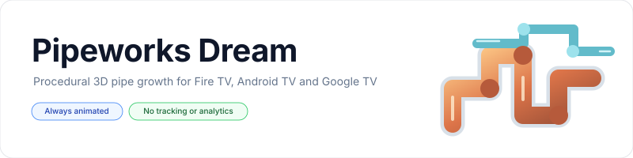
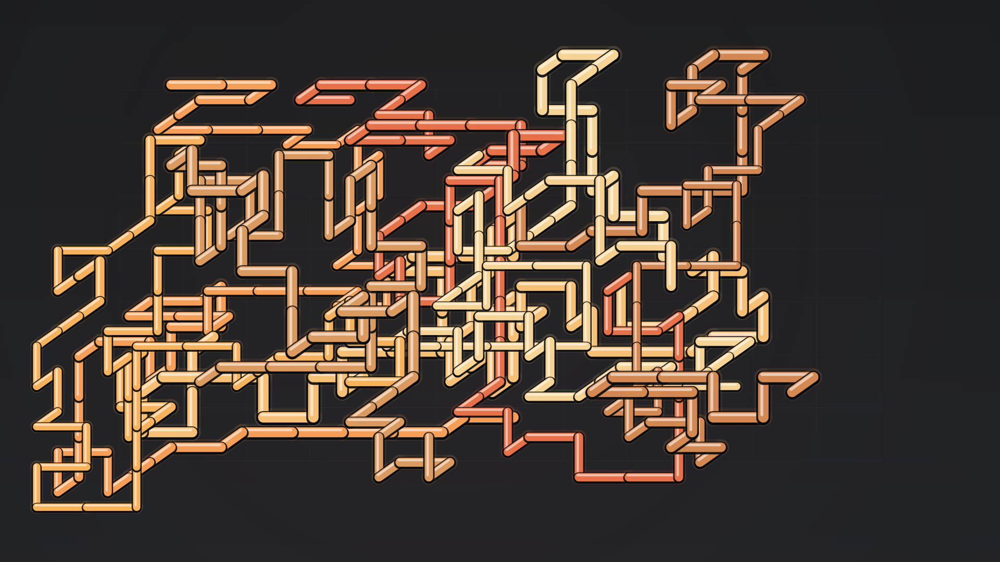
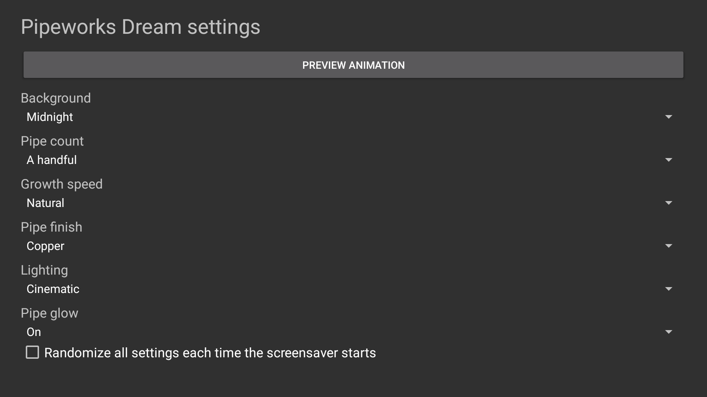

<p align="center">
    <picture>
        <source media="(prefers-color-scheme: dark)" srcset="art/banner-dark.svg">
        <source media="(prefers-color-scheme: light)" srcset="art/banner-light.svg">
        
    </picture>
</p>

<p align="center">A continuously animated 3D pipe-growth screensaver for Fire TV, Android TV, and Google TV.</p>

<p align="center">
<a href="https://github.com/jeremykenedy/pipeworks-dream/releases"></a>
<a href="https://github.com/jeremykenedy/pipeworks-dream/releases"></a>
<a href="https://github.com/jeremykenedy/pipeworks-dream/actions/workflows/ci.yml"></a>
<a href="https://github.com/jeremykenedy/pipeworks-dream/actions/workflows/style.yml"></a>
<a href="https://github.com/jeremykenedy/pipeworks-dream/actions/workflows/docs.yml"></a>
<a href="https://github.com/jeremykenedy/pipeworks-dream/actions/workflows/security.yml"></a>
<a href="LICENSE"></a>
<a href="https://github.com/jeremykenedy"></a>
<a href="https://github.com/jeremykenedy/pipeworks-dream"></a>
<a href="https://github.com/jeremykenedy/pipeworks-dream/stargazers"></a>
<a href="https://github.com/sponsors/jeremykenedy"></a>
</p>

## Table of Contents

- [Overview](#overview)
- [Privacy](#privacy)
- [Features](#features)
- [Device verification](#device-verification)
- [Requirements](#requirements)
- [Installation](#installation)
- [Fire TV Toolkit](#fire-tv-toolkit)
- [Configuration](#configuration)
- [Screenshots](#screenshots)
- [Building and testing](#building-and-testing)
- [Documentation](#documentation)
- [Release notes](#release-notes)
- [License](#license)

## Overview

Pipeworks Dream grows a changing network of polished, angular pipes through a softly lit three-dimensional grid. It renders locally with Android Canvas and needs no media downloads or service connection.

## Privacy

The app has no ads, analytics, tracking, telemetry, crash reporting, or runtime network access. It does not request the Android internet permission. The optional installer only contacts GitHub when you run it to fetch the latest APK and its checksum; it does not send device or usage information.

## Features

- Continuous procedural pipe growth with metallic bevels, elbow joints, reflections, and optional glow.
- Choose a few, a handful, many, a ton, or schools of pipes.
- Adjust growth speed, copper/cool/neon/monochrome finishes, midnight/ocean/graphite backgrounds, and subtle/cinematic/bright lighting.
- Set each option to Random, or randomize all settings when the screensaver starts.
- Remote-friendly settings and live preview, with a documented provider interface for host apps.
- Android DreamService with no internet permission, ads, bundled third-party assets, or runtime service dependencies.
- Guided ADB installer and uninstaller. Device settings are left unchanged.

## Device verification

The table distinguishes emulator checks from physical-device validation. A working emulator preview does not establish vendor-specific idle activation or display performance.

| Platform | Device and OS | Result |
| --- | --- | --- |
| Android TV emulator | `sdk_google_atv64_arm64`, Android 12/API 31, 1920x1080 | APK installed; settings and preview opened; animation screenshot inspected. System Dream picker was unavailable, so idle activation is unverified. |
| Fire TV | No physical device available | Looking for a Fire TV owner to test DreamService selection, idle activation, remote behavior, and wake/resume, then report the model, Fire OS version, resolution, and results in [Issues](https://github.com/jeremykenedy/pipeworks-dream/issues). |
| Google TV | No physical device available | Looking for a Google TV owner to test system selection, idle activation, remote behavior, and wake/resume, then report the model, Android TV OS version, resolution, and results in [Issues](https://github.com/jeremykenedy/pipeworks-dream/issues). |

## Requirements

The APK targets Android 6.0 (API 23) or later. The system must expose Android DreamService screensavers for selection. Actual availability and idle activation depend on device firmware and settings.

## Installation

Connect the TV or emulator over ADB, then run:

```bash
python3 install.py --serial TV_IP:5555
```

The installer verifies the latest release APK against the published SHA-256 before installation. Open Pipeworks Dream from the launcher to configure it, then select it in the system screensaver or ambient-display settings. The installer does not change the selected saver, timeout, power, sleep, or update settings.

Use `python3 install.py --help` for options. A local APK can be installed with `--apk PATH`; removal requires an interactive confirmation or the explicit `--uninstall --yes --force` flags. See [installation](docs/INSTALLATION.md) for the complete flow and safety behavior.

## Fire TV Toolkit

[Fire TV Toolkit](https://github.com/jeremykenedy/fire-tv-toolkit) provides a guided terminal setup and verified screensaver install, update, and removal commands for Fire TV. After Pipeworks Dream is listed in the Toolkit catalog, run:

```bash
git clone https://github.com/jeremykenedy/fire-tv-toolkit.git
cd fire-tv-toolkit
node setup.js

firetv-screensavers --install=pipeworks
screensaver --set=pipeworks
```

To update Pipeworks Dream, run `firetv-screensavers --install=pipeworks` again; the Toolkit downloads the latest release and verifies its SHA-256. To remove it, run `firetv-screensavers --uninstall=pipeworks --force`. Toolkit commands also manage Fire TV screensaver optimization and timeouts, the Alexa deep-sleep fix, its on-TV picker, optional AT4K launcher, and saved-setting reversion. Its optional `guard` restores selected screensaver, timeout, and Alexa settings after certain platform or app changes. Some protected system updater packages cannot be disabled, and an update may still proceed; the Toolkit documents those limits and provides `guard --check` to reconcile settings afterward. Changes are explained before confirmation. These Toolkit controls apply to supported Fire TV devices; they do not establish physical-device validation for this app or apply to Android TV and Google TV. See Toolkit [installation](https://github.com/jeremykenedy/fire-tv-toolkit#installation), [commands](https://github.com/jeremykenedy/fire-tv-toolkit/blob/main/docs/COMMANDS.md), [guard behavior](https://github.com/jeremykenedy/fire-tv-toolkit/blob/main/docs/GUARD.md), and [revert guidance](https://github.com/jeremykenedy/fire-tv-toolkit/blob/main/docs/COMMANDS.md#reverting-and-removing).

## Configuration

Open Pipeworks Dream from the TV launcher. Settings take effect when the saver starts and are stored locally. See [configuration](docs/CONFIGURATION.md) for the available choices and the settings-provider contract.

| Setting | Choices | Default |
| --- | --- | --- |
| Pipe count | A few, A handful, Many, A ton, Schools, Random | A handful |
| Growth speed | Slow, Natural, Quick, Random | Natural |
| Pipe finish | Copper, Cool steel, Neon, Monochrome, Random | Copper |
| Background | Midnight, Deep ocean, Graphite, Random | Midnight |
| Lighting | Subtle, Cinematic, Bright, Random | Cinematic |
| Pipe glow | On, Off, Random | On |
| Randomize all | On or Off | Off |

## Screenshots

Screenshots are captured from Pipeworks Dream running on an Android TV emulator after the scene has settled. The settings screen is captured separately from the animation.

<p align="center"></p>

<p align="center"></p>

## Building and testing

Build requirements are JDK 17 or later, Android SDK platform 36, build-tools 36.0.0, Python 3, and ADB for emulator/device checks. Run `bash build.sh` to create a locally signed APK. Run the following checks before contributing:

```bash
bash test.sh
bash scripts/test-coverage.sh
bash scripts/test-python-coverage.sh
bash scripts/check-style.sh
python3 scripts/check-docs.py
python3 scripts/check-privacy.py
```

CI enforces 100% line and branch coverage for the app's pure Java settings and pipe-growth logic, and for the standalone installer. Android framework lifecycle code is verified through emulator checks and APK manifest inspection. See [building](docs/BUILDING.md), [testing](docs/TESTING.md), and [CI](docs/CI.md).

## Documentation

- [Architecture](docs/ARCHITECTURE.md)
- [Building](docs/BUILDING.md)
- [CI](docs/CI.md)
- [Configuration and provider](docs/CONFIGURATION.md)
- [Installation and uninstall](docs/INSTALLATION.md)
- [Release process](docs/RELEASING.md)
- [Testing](docs/TESTING.md)
- [Troubleshooting](docs/TROUBLESHOOTING.md)
- [Device verification](docs/VERIFICATION.md)
- [Security policy](SECURITY.md)

Show some love by starring this repository on GitHub. The Star button links to the repository; GitHub requires each visitor to click it while signed in.

## Release notes

- [Pipeworks Dream 1.0.0](docs/releases/v1.0.0.md)

## License

Pipeworks Dream is licensed under the [Apache License, Version 2.0](LICENSE). See [NOTICE](NOTICE) for project notices.
