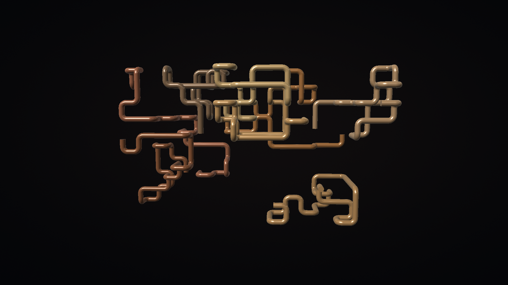
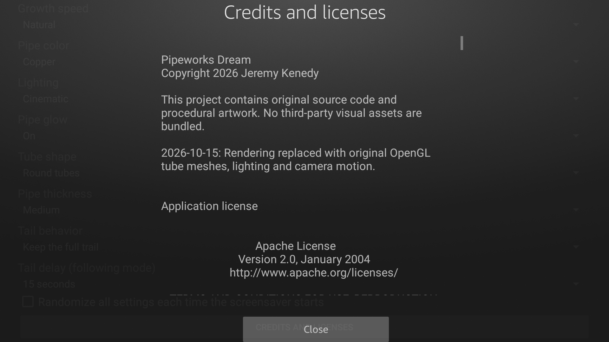
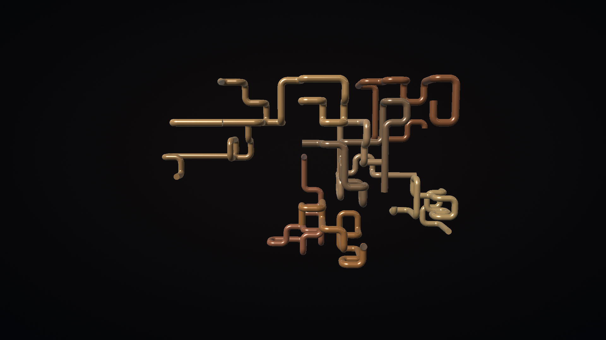
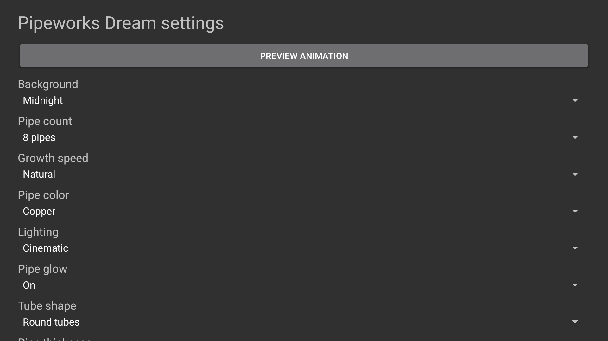
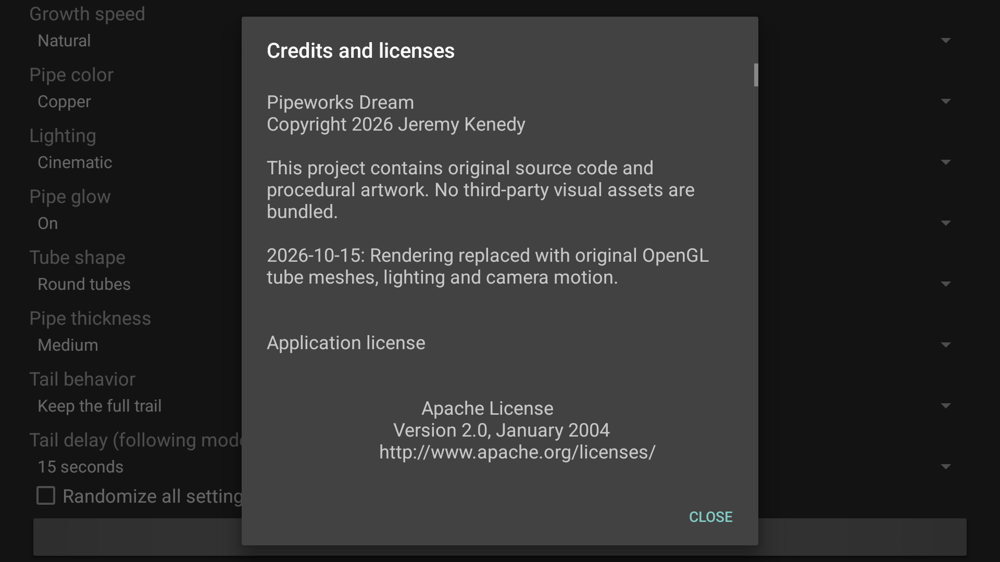
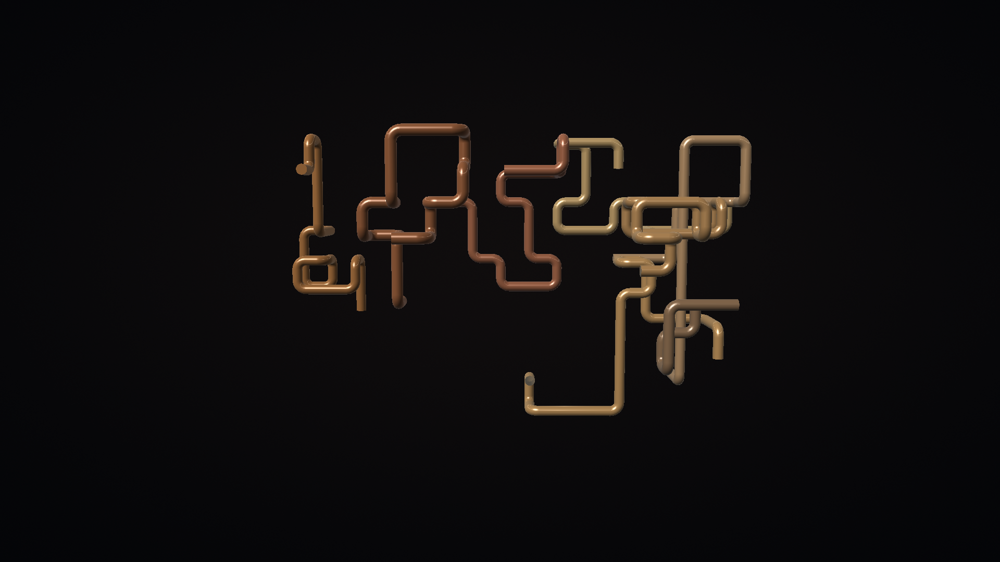

# Native screenshot gallery

The first three rows are unmodified 1920x1080 physical Fire TV AFTDEC012E/API30 captures from October 22, 2026. The first row uses the exact final signed credits APK a964; the next two rows exercise the unchanged renderer baseline. That renderer baseline APK is `bbe734c33c32409a52bb2179ecd1d3f712395477b31b3906d02582131ba2e6a1`. Its unchanged rendering classes and resources are recorded in the verification guide.

<table>
<tr>
<td> Preview</td>
<td> Credits</td>
<td> Dream</td>
</tr>
<tr>
<td> Round</td>
<td> Square</td>
<td> Hex</td>
</tr>
<tr>
<td> Dense at 40 seconds</td>
<td> Dense at 75 seconds</td>
<td> Dream</td>
</tr>
<tr>
<td> Settings</td>
<td> Credits</td>
<td> Dream</td>
</tr>
</table>

The last row shows the exact credits APK `a9642a20efe37fd3b39974d04f59b17eb4940935dbaca60c4b6cbf655eef03d0` on the API34 ARM64 Google TV emulator. Remote Preview/Back, Credits scrolling, bound DreamService/Back and exact 11-preference/five-system-value restoration passed. These short route captures do not replace the physical renderer measurements.

[Capture provenance](../art/screenshots/physical-provenance.json) records artifact and image hashes. [Device verification](VERIFICATION.md) separates short physical measurements, emulator controls and unverified idle/thermal behavior.

[Final physical credits/update provenance](../art/screenshots/final-physical-provenance.json) records installed-byte verification, remote routes and complete restoration. Moving review remains pending before release.
