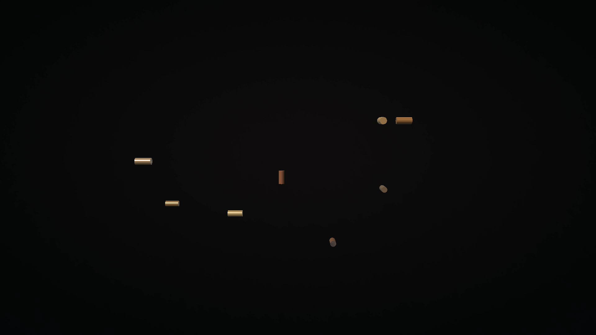
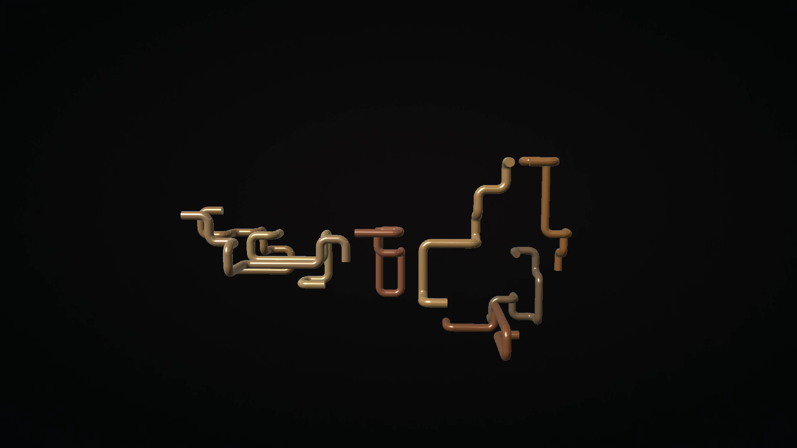
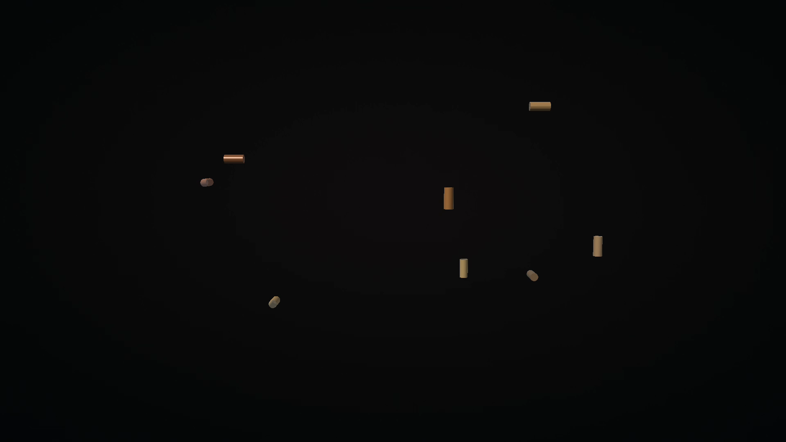
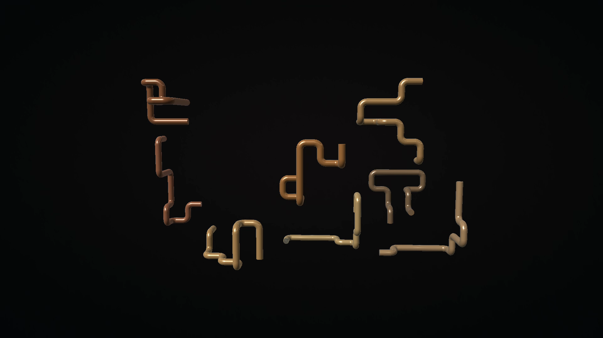
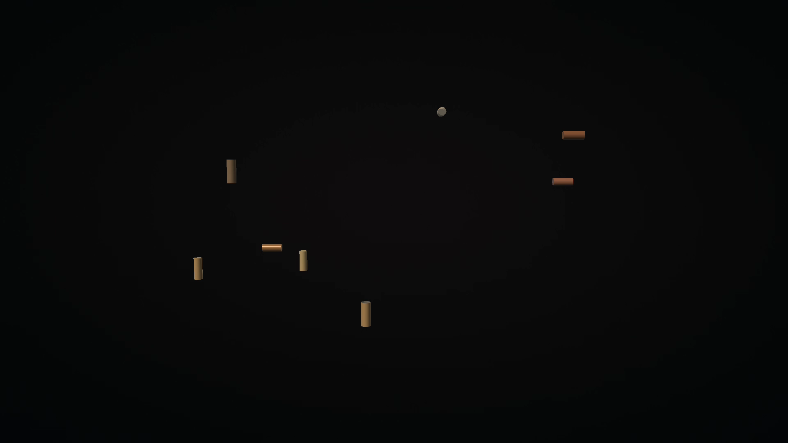
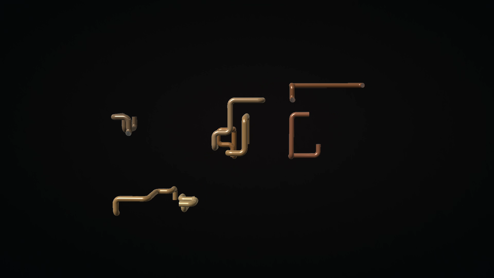

# Native screenshot gallery

## Pipeworks 1.1.1 startup

These unaltered frames come from native 1920x1080 recordings of the signed
1.1.1/code3 APK on the Google TV ARM64 API34 emulator on October 29, 2026.
The dark first frames are the deliberately empty rendered background, followed
by the first short segments and then a developed pipe network.

The second and third rows show two successive actual bound DreamService sessions
started through the system's preview mode (`isPreview=true`, `mBound=true`).
They verify fresh service startup and growth with persistent and following tails.
They do not establish normal or automatic idle activation. Back detached each
session; ordinary Preview Home/resume retained its existing activity and scene.

<table>
<tr>
<td> Fresh Preview: Empty scene</td>
<td> Fresh Preview: First segments</td>
<td> Fresh Preview: Growing pipes</td>
</tr>
<tr>
<td> First DreamService session: Empty scene</td>
<td> First DreamService session: First segments</td>
<td> First DreamService session: Growing pipes</td>
</tr>
<tr>
<td> Second DreamService session, following tails: Empty scene</td>
<td> Second DreamService session, following tails: First segments</td>
<td> Second DreamService session, following tails: Growing pipes</td>
</tr>
</table>

[1.1.1 capture provenance](../art/screenshots/startup111-native-provenance.json)
records the tested APK, production certificate, recording and image hashes, and
verification limits. All 11 app options, 14 UI preferences, and 19 sampled system
values were restored exactly. The following captures document the earlier
1.1.0 release and are not physical validation of 1.1.1.

## Historical 1.1.0 captures

The first three historical rows are unmodified 1920x1080 physical Fire TV AFTDEC012E/API30 captures from October 22, 2026. The first row uses the exact final signed credits APK a964; the next two rows exercise the unchanged renderer baseline. That renderer baseline APK is `bbe734c33c32409a52bb2179ecd1d3f712395477b31b3906d02582131ba2e6a1`. Its unchanged rendering classes and resources are recorded in the verification guide.

<table>
<tr>
<td> Preview</td>
<td> Credits</td>
<td> Dream</td>
</tr>
<tr>
<td> Round</td>
<td> Square</td>
<td> Hex</td>
</tr>
<tr>
<td> Dense at 40 seconds</td>
<td> Dense at 75 seconds</td>
<td> Dream</td>
</tr>
<tr>
<td> Settings</td>
<td> Credits</td>
<td> Dream</td>
</tr>
</table>

The last row shows the exact credits APK `a9642a20efe37fd3b39974d04f59b17eb4940935dbaca60c4b6cbf655eef03d0` on the API34 ARM64 Google TV emulator. Remote Preview/Back, Credits scrolling, bound DreamService/Back and exact 11-preference/five-system-value restoration passed. These short route captures do not replace the physical renderer measurements.

[Capture provenance](../art/screenshots/physical-provenance.json) records artifact and image hashes. [Device verification](VERIFICATION.md) separates short physical measurements, emulator controls and unverified idle/thermal behavior.

[Final physical credits/update provenance](../art/screenshots/final-physical-provenance.json) records installed-byte verification, remote routes and complete restoration. Independent review of the exact final physical movie accepted its continuous motion. The public gallery was verified at 1280 and 320-pixel browser widths.
