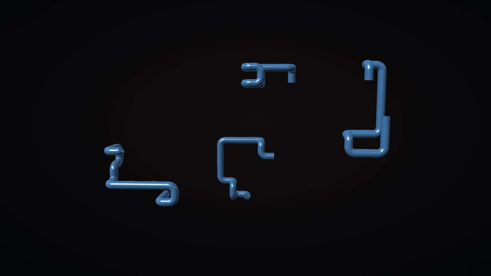
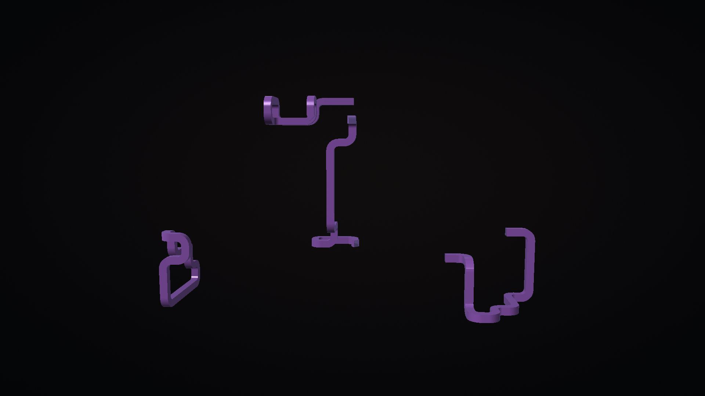
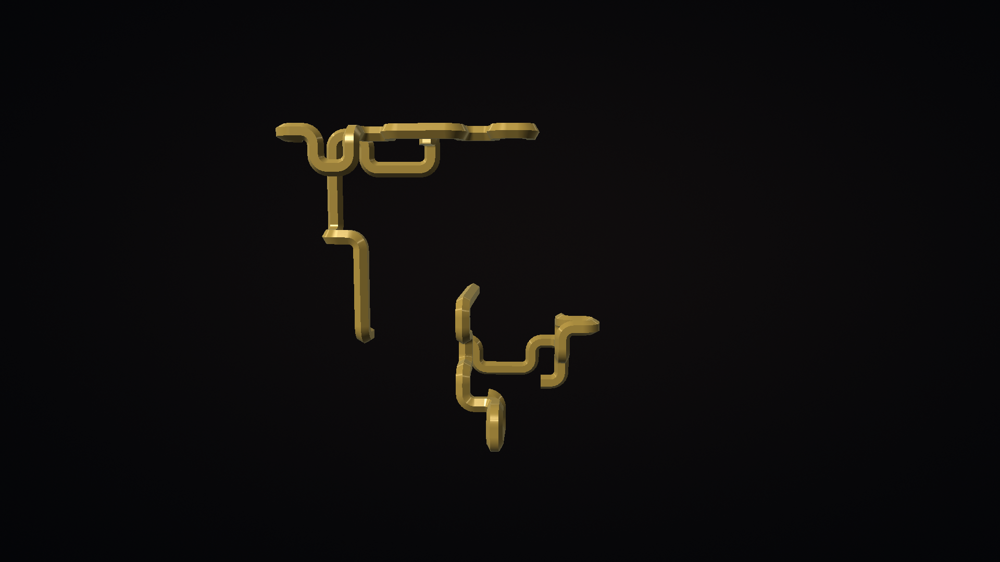
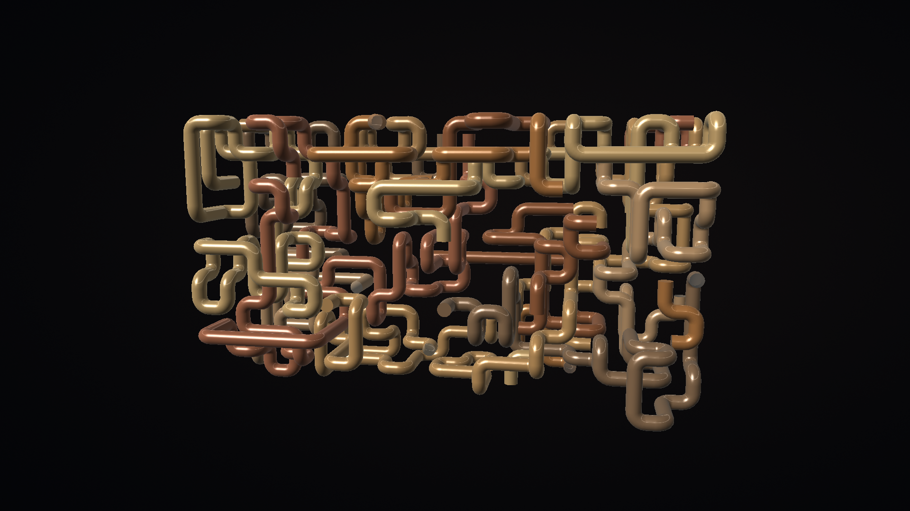
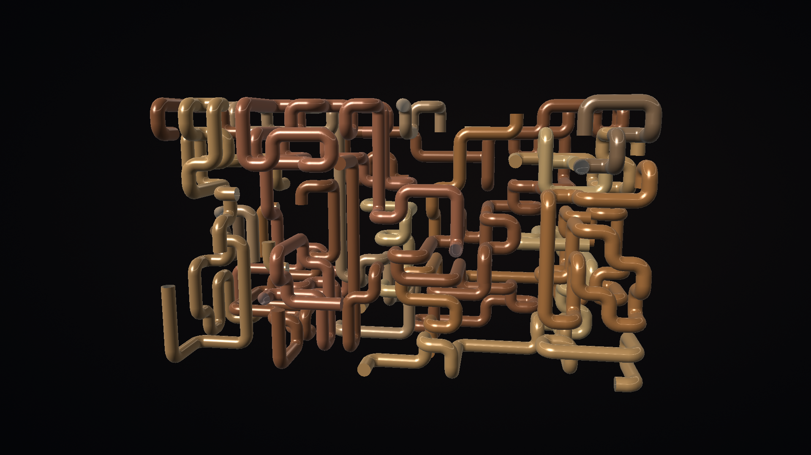
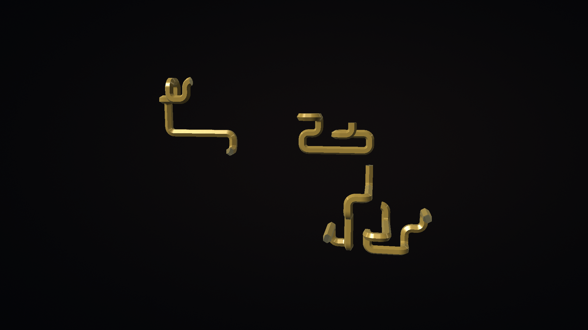

# Native screenshot gallery

These unmodified 1920x1080 captures came from physical Fire TV AFTDEC012E/API30 on October 22, 2026. The renderer baseline APK is `bbe734c33c32409a52bb2179ecd1d3f712395477b31b3906d02582131ba2e6a1`. Final offline credits are a separate small build change; its unchanged rendering classes and resources are recorded in the verification guide.

<table>
<tr>
<td> Round</td>
<td> Square</td>
<td> Hex</td>
</tr>
<tr>
<td> Dense at 40 seconds</td>
<td> Dense at 75 seconds</td>
<td> Dream</td>
</tr>
</table>

[Capture provenance](../art/screenshots/physical-provenance.json) records artifact and image hashes. [Device verification](VERIFICATION.md) separates short physical measurements, emulator controls and unverified idle/thermal behavior.
