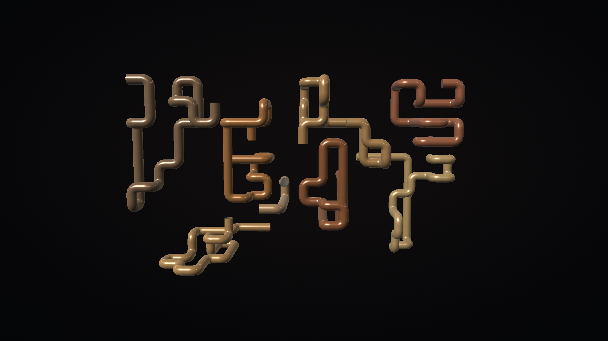
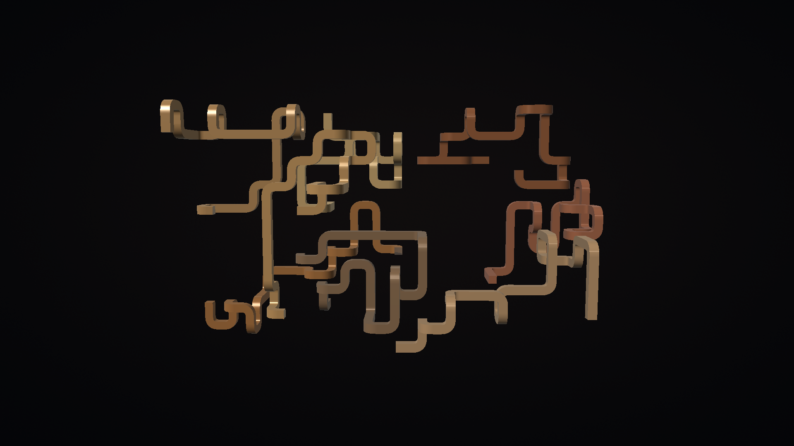
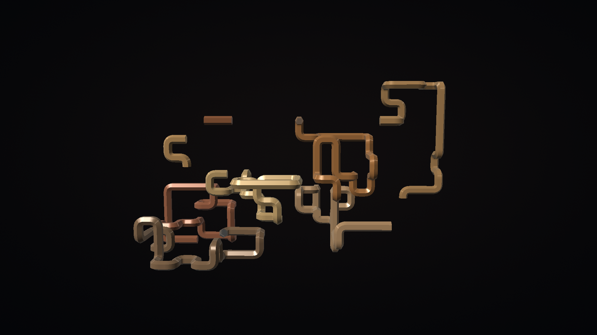
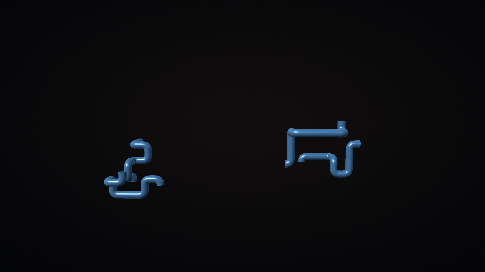
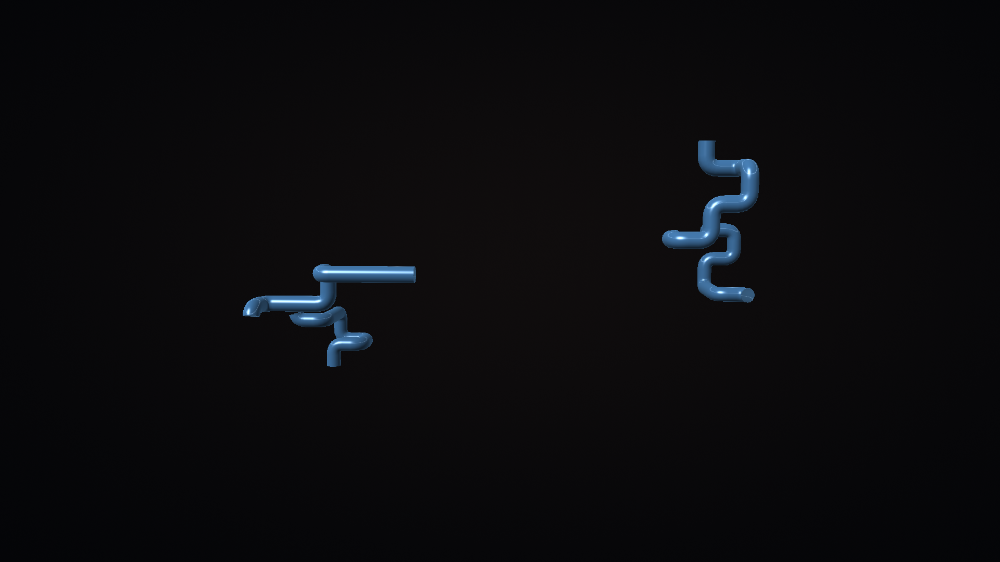

# Verification

## Physical renderer validation on October 22, 2026

The exact signed 1.1.0/code2 renderer baseline was `bbe734c33c32409a52bb2179ecd1d3f712395477b31b3906d02582131ba2e6a1`, 58,061 bytes, with the preserved production signer `d496ee9655c19cd60169675f806718bc3094bf8dd4c20a7cf8a74cabb93d0c86`. It passed a physical AFTDEC012E/API30 run with current round, square and hexagonal shapes, dense 28-pipe thick/quick growth, remote Preview/Back and actual DreamService after 45 seconds followed by Back. Native captures were visually reviewed. Normal playback of the 13-second movie showed continuous growth, rounded elbows, depth, metallic highlights and camera motion with no incidental words or watermark.

Two SurfaceFlinger presentation samples for the actual preview surface measured 27.35296 presents/second after 40 seconds and 24.27201 after 75 seconds. Their maximum intervals were 50.12 ms and 50.24 ms. These are short presentation samples, not an extended FPS, native 4K, idle-power or thermal guarantee. All 11 preferences and five sampled system values were restored exactly, including the original asleep state.

The final credits candidate is `a9642a20efe37fd3b39974d04f59b17eb4940935dbaca60c4b6cbf655eef03d0`, 62,276 bytes. It adds only an offline Credits and licenses dialog, its settings button and bundled NOTICE/LICENSE. All six original nonDEX APK entries, including manifest, resources and embedded preview, are byte-identical to the tested baseline. All 21 compiled classes outside SettingsActivity also match the preserved baseline build byte-for-byte. The [compiled-class and resource record](../art/screenshots/credits-runtime-equivalence.json) identifies the matching entries. The DEX and whole APK differ; the final native credits/Preview/Dream routes passed on the API34 ARM64 emulator. The exact final APK then passed its own physical route check described below.

The [physical gallery](SCREENSHOTS.md) and [public provenance](../art/screenshots/physical-provenance.json) contain only scene captures and measurements, without private device preferences or addresses.

## Final credits APK physical routes

On October 22, 2026 the exact a964 APK updated the original physical AFTDEC012E/API30 package in place. The installed APK was pulled back and matched all 62,276 bytes and the production certificate. All 11 existing preferences survived. Actual D-pad Settings/Preview/Back, Credits/scroll/Back and a protected-receiver-selected bound DreamService/Back passed. Final scene and license captures were visually inspected. Independent normal-playback review of the exact final movie accepted continuous growth and retraction, glossy elbows and subtle camera motion.

The check restored all 11 app preferences and eight sampled OS values exactly, restored the original Asleep state, kept the picker's foreground protection active and left its existing backup byte-for-byte unchanged. No picker force-stop, guard-policy, equipment or timer changes were made. The [final physical record](../art/screenshots/final-physical-provenance.json) contains no private preferences or network address. The earlier dense presentation measurements still apply to the byte-identical rendering classes and resources; they were not repeated for the credits-only update.

## Final credits APK native routes

On October 22, 2026 the exact a964 credits candidate passed remote Settings to Preview and Back, Credits and license scrolling, and a nonpersistent actual bound DreamService followed by Back/detachment. All 11 app values and five system values matched their before/after snapshots exactly; the app stopped at Home. The first installation upgraded the old 1.0 emulator package: its seven existing provider values were preserved and the new shape/size/tail/tail-delay keys reported their expected defaults. A whole-dictionary equality assertion initially mistook those additive keys for a loss; the corrected subset migration check and final 11-key restoration passed without an app change. License scrolling was verified, but the bounded route test did not scroll to the document's bottom.

The [gallery](SCREENSHOTS.md) shows this final APK's Settings, Credits and DreamService. [Native provenance](../art/screenshots/final-native-provenance.json) records image hashes and test limits. Final physical functional routes and independent moving review passed.

## Earlier 1.1.0 emulator source candidate

The 2026-10-15 Google TV API 34 host-GPU emulator check used signed APK SHA-256 `b17d4b842001e8f7160f84b5c4891797aa4a8b16a0ab3e7467a58c9015998137`. Its signing certificate SHA-256 `d496ee9655c19cd60169675f806718bc3094bf8dd4c20a7cf8a74cabb93d0c86` matches the published 1.0.0 artifact. The final package rebuild only refreshes its small embedded preview from this native capture.

The 1920x1080 scene was captured after settling and after a 12-second native screen recording. Successive frames show ongoing growth with true quarter-circle centerlines. Native Back returned to settings, and all 11 saved provider values read back unchanged. The current README captures and embedded preview derive from that run. No physical TV selection, timer or enabled state was changed by this emulator check.

This earlier emulator check preceded the physical shape and maximum-density tests recorded above. A native 60-second tail-delay observation, automatic idle activation, native 4K and long-duration thermal/power behavior remain unverified. Older physical measurements below describe their stated candidate, not a retest of every expanded option.

## Host checks

The Java coverage gate includes settings resolution, provider values, occupied-cell growth, and tube-mesh construction. It enforces 100% line and branch coverage. Geometry regressions prove constant-radius quarter-circle centerlines and positive inner clearance for thick bends. They also check circular cross sections, curved normals, outward winding, chain separation, finite coordinates and per-segment reveal bounds over 200 engine snapshots. The installer has 24 tests and 100% line and branch coverage. Framework rendering and lifecycle require native checks and are not counted as host coverage.

## Native device matrix

| Platform | Device | Result |
| --- | --- | --- |
| Physical Fire TV | AFTDEC012E, Android API 30, 1920x1080 captured output | Signed in-place upgrade from 1.0.0 installed successfully. Preview displays rounded, lit tube meshes with continuous growth and camera movement. Settings opened and D-pad navigation opened its choices. See motion evidence below. |
| Android TV emulator | API 31, `emulator-5584` | Fire TV UI opened this app's declared settings activity and restored the original selection after the route test. |
| Physical Android TV / Google TV | Not available | A volunteer with these devices is needed to test selection, idle activation, remote controls and wake/resume. Please report model, OS/API, resolution and results through the repository issue tracker. |

No native 4K, automatic idle startup, reboot persistence, long-duration thermal or idle-power claim is made. Manual DreamService activation is tested separately from automatic idle activation.

## Motion evidence

On 2026-10-15 a 12-second, 1920x1080 Fire TV screen recording exposed pauses in the initial synchronous mesh renderer: approximately 26 captured frames/second after settling, with a 150 ms 95th-percentile frame interval. Mesh construction was moved to a single background worker and geometry uploaded through a GPU buffer.

The corresponding final-worker capture measured 30.09 captured frames/second after its first second, median interval 33.30 ms, 95th percentile 48.97 ms and maximum 53.18 ms. These are screen-recording frame timestamps under capture load, not direct GPU timing or a sustained performance guarantee. Fire OS returned no per-layer latency samples. The original measurements and recordings are local build artifacts.

The process snapshot during the initial sustained preview used about 120 MiB total PSS. This is a point measurement, not a memory ceiling. The Fire OS thermal service reported status 0 and CPU 60 C during the same short session; this does not establish long-duration thermal behavior.

## Captures and settings

`art/screenshots/pipeworks-fire-tv-preview.png` and `pipeworks-fire-tv-settings.png` are unmodified screenshots of the running native app. The DreamService capture is recorded separately after 45 seconds of settling. There are no scene words or watermarks. The small packaged preview is derived from an actual native capture.

The original physical TV selection was Aquarium Live and screensavers were enabled. Temporary DreamService selection uses Fire TV UI's protected receiver and restores both original values. No timer, update or power settings are changed by this test or the app installer.

## Expanded controls and following tail

On 2026-10-15 the expanded 1.1.0 candidate was installed on the dedicated Android TV API 31 emulator `emulator-5584` at 1920x1080. The tested APK SHA-256 was `4c5d4e4d9f7c1c7d31b8b4c218537a5a232116aa69f38514fd98248608ed6771`.

D-pad navigation selected Quick growth, Purple color, Square ducts, Thick pipes, Tail follows the growing end, and 5 seconds. Provider readback confirmed every selected value. All six choices survived a process stop and settings relaunch. The [selected controls capture](../art/screenshots/pipeworks-selected-controls-android-tv.png) shows those choices; the [restored controls capture](../art/screenshots/pipeworks-expanded-controls-android-tv.png) shows the original settings after testing.

The native provider rejected `palette=orange`, `shape=triangle`, `size=huge`, `tail=maybe`, and `tail_delay=10` with `Unsupported setting value`. All 11 preference values stayed unchanged after each rejected update.

Round, square, and hexagonal sections were captured from the running OpenGL ES preview using Copper, Thick, Natural growth, eight pipes, Cinematic lighting, Midnight background, and Keep the full trail. The captures show smooth round highlights, flat square faces, and distinct hexagonal facets and end caps.

<table>
  <tr>
    <td> Round tubes</td>
    <td> Square ducts</td>
    <td> Hexagonal tubes</td>
  </tr>
</table>

Following-tail verification used four Blue, Thick, Round pipes with Natural growth and a 5-second delay. Captures were requested at approximately 2, 4, 7, 10, and 13 seconds after preview launch completed. The initial trails grow; later frames remove old portions while their leading ends continue growing. Reviewing successive frames from the local screen recording also showed the oldest ends moving through a turn between complete engine steps.

<table>
  <tr>
    <td> About 4 seconds</td>
    <td> About 7 seconds</td>
    <td> About 13 seconds</td>
  </tr>
</table>

The local `/tmp/pipeworks-following-tail.mp4` recording contains 12.381 seconds of encoded video. These captures establish visible tail motion on this emulator; they are not a frame-rate or exact wall-clock delay measurement. The longer-delay point limits are verified by the host tests rather than a one-minute native observation.

Two Home/resume/Back cycles passed. Home moved the preview into the background, resuming the existing preview rendered the scene again, and Back returned to settings. The [resumed scene](../art/screenshots/pipeworks-resumed-android-tv.png) was inspected. No AndroidRuntime fatal exception was recorded during the expanded controls, shape, tail, and lifecycle checks. All 11 original provider values were restored and read back unchanged. The physical TV was not used for these expanded-option checks.
